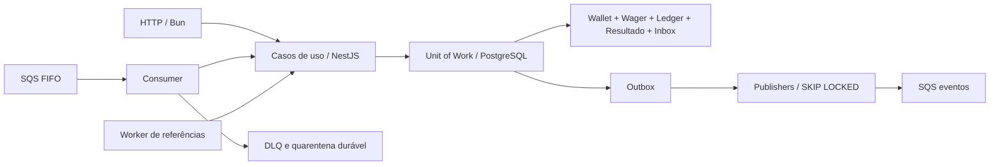

# Distributed Wagering Processor — arquitetura

## Organização e fluxo

HTTP e SQS executam o mesmo `ProcessWager`. PostgreSQL é a autoridade financeira;
SQS e outbox entregam **at-least-once**, com deduplicação persistente de efeitos.

| Diretório | Responsabilidade |
| --- | --- |
| `src/domain` | Money, entidades, transições e invariantes; sem framework, I/O ou relógio global |
| `src/application` | Processamento, idempotência, retry e portas de persistência/telemetria |
| `src/infrastructure/persistence` | MikroORM, SQL, mapeadores e migrations |
| `src/infrastructure/messaging` | SQS, Inbox/dispositions, heartbeat, outbox e referências |
| `src/infrastructure/http` | Contratos HTTP, extensão de identidade e servidor |
| `src/infrastructure/health` | Probes ativos de PostgreSQL e SQS |
| `src/infrastructure/observability` | Contexto assíncrono, logger JSON e métricas |

NestJS gerencia DI, módulos e shutdown com factories explícitas, sem depender de
emissão de metadata de decorators. O transporte HTTP usa `Bun.serve`; o handler
é compartilhado pela API e pelo teste de carga. Não depende de Express/Fastify.
Executar a API em Node exige substituir esse adapter, preservando os casos de uso.

## ORM, Money e estratégia transacional

**MikroORM 6** foi escolhido pelo Unit of Work explícito, identity map por sessão,
EntitySchema desacoplado do domínio e suporte a locks/migrations SQL manuais.
TypeORM seria viável; não há benefício em manter dois ORMs. As invariantes não
dependem exclusivamente da validação do ORM.

`Money` usa centavos em `bigint`. JSON e persistência transportam strings decimais,
preservadas pelo `DecimalStringType`. Dinheiro nunca é convertido em `number`.
O banco usa `numeric` **sem typmod**, com CHECK de escala <= 2, magnitude absoluta
< 10^36 e rejeição de NaN/infinito. `numeric(38,2)` poderia arredondar antes da
validação. Não há arredondamento implícito: `1.005` e `1.000` são inválidos;
`001.2` normaliza para `1.20`. Moeda é validada como três letras ASCII maiúsculas.

Cada UoW abre `em.fork({ clear: true, useContext: false })` e transação READ COMMITTED.
Repositórios só são válidos dentro do callback. A promise resolve depois de flush,
constraints diferidas e COMMIT. Wallet, wager, ledger, resultado original, Inbox e
Outbox são confirmados juntos. A UoW financeira não chama rede. Os limites SQL são
`lock_timeout=5s` e `statement_timeout=15s`, não um deadline total da requisição.

## Concorrência: hot wallet e múltiplas instâncias

A estratégia principal é **lock pessimista por wallet**, `SELECT ... FOR UPDATE`.
Saldo, insuficiência de fundos e reversões são decididos sob esse lock. Uma hot
wallet serializa decisões; wallets distintas progridem em paralelo. A versão é
sequência auditável, não compare-and-swap otimista. Lock otimista geraria mais
trabalho descartado sob alta disputa.

Antes das leituras, advisory locks transacionais protegem chave de idempotência,
ID externo e identidade de Inbox, inclusive quando ainda não existem linhas.
SHA-256 reduz essas chaves a inteiros assinados de 64 bits, ordenados antes da
aquisição. Colisão apenas serializa operações adicionais: constraints comparam
as identidades originais. Referências processadas são snapshots imutáveis;
consultá-las não adquire locks de outra wallet.

Com **>= 3 instâncias**, todas disputam locks no mesmo PostgreSQL, sem mutex local.
Duas BETs de 80 sobre 100 produzem um débito, uma rejeição e saldo 20; não há
garantia de qual vence. FIFO reduz disputa, mas não garante correção sozinho.
Deadlock, serialization failure e lock timeout provocam rollback e até quatro
tentativas totais, com pausas 25/50/100ms mais jitter de 0–24ms. Constraints
específicas de dedup/reversão também permitem retry. Commit ambíguo volta ao
transporte; reenviar a mesma chave resolve pela persistência. A duração e os
conflitos desses locks seguem a [documentação PostgreSQL](https://www.postgresql.org/docs/17/explicit-locking.html).

## Modelagem e invariantes

| Operação | Valor | Efeito/referência |
| --- | --- | --- |
| OPENING | Positivo | Crédito interno; proibido em HTTP/SQS |
| BET | Positivo | Débito; sem referência |
| WIN | Positivo | Crédito; referência opcional a BET |
| LOSS | Zero | Sem ledger; referência opcional a BET |
| REFUND | Igual à BET | Crédito integral de BET processada |
| ROLLBACK | Igual à referência | Inverte BET, WIN ou REFUND processada |

Wallet tem unicidade `(playerId, currency)`, saldo não negativo e versão inicial 1.
Abertura positiva cria OPENING e ledger CREDIT atomicamente; abertura zero não
cria movimento. Ledger é imutável no domínio e protegido contra UPDATE, DELETE e
TRUNCATE por triggers. Cada linha satisfaz `balanceBefore ± money = balanceAfter`;
existe no máximo uma por `(walletId, transactionId)`. Constraints diferidas
verificam coerência financeira no commit. Não é contabilidade de partidas dobradas.

REFUND/ROLLBACK validam provider, player, wallet, moeda, rodada, tipo e valor integral
da referência. Igualdade de `gameId` não é exigida, mas ele entra no hash. Reversões
são consultadas sob lock da wallet e reforçadas por índice único parcial
`(reference_transaction_id, kind)` para PROCESSED. A regra é **uma reversão por
tipo**: REFUND e ROLLBACK da mesma BET são permitidos separadamente. Reversão
parcial é fora de escopo. ROLLBACK que causaria saldo negativo tem erro distinto.

| Estado | Próximos estados |
| --- | --- |
| PENDING | PENDING_REFERENCE, PROCESSED, REJECTED, FAILED |
| PENDING_REFERENCE | PENDING_REFERENCE, PROCESSED, REJECTED, FAILED |
| PROCESSED, REJECTED, FAILED | Nenhum |

REJECTED não move saldo. FAILED existe no domínio, mas erros técnicos desconhecidos
atualmente fazem retry/quarentena, sem criar uma falha financeira terminal. A série
FAILED é exposta com zero enquanto não houver transições confirmadas para ela.

Reconciliação bloqueia a wallet e soma o ledger em `numeric` na mesma conexão,
incluindo abertura. Divergência retorna `consistent:false`, log sem valores e
métrica. Não corrige saldo silenciosamente. A consulta custa O(histórico) e mantém
o lock durante a execução.

## Hash canônico, idempotência e Inbox

`WagerTransaction.canonicalPayload` ordena lexicograficamente as chaves, inclusive
em `money`. Inclui `externalTransactionId`, `gameId`, `kind`, `money`, `playerId`,
`providerId`, `referenceExternalTransactionId`, `roundId`, `walletId`. Referência
ausente vira `null`; dinheiro tem duas casas. Calcula-se **SHA-256 dos bytes UTF-8**,
hexadecimal minúsculo. Timestamp, ID interno, correlationId, messageId, chave de
idempotência e metadados de transporte ficam fora. Hash recebido não é confiável.

O header HTTP `Idempotency-Key` é obrigatório e prevalece sobre o body. No SQS,
a chave vem de `idempotencyKey`. Unicidades `(providerId, idempotencyKey)` e
`(providerId, externalTransactionId)` impedem duplicação. Replay idêntico retorna
resultado original, incluindo saldo/version, com `idempotentReplay:true`. Payload
divergente ou ID externo com outra chave é conflito.

A Inbox identifica `(consumerName, MessageId real do SQS)`, sem confiar em IDs do
body. Seu fingerprint é SHA-256 de `JSON.stringify({ idempotencyKey, payloadHash })`,
nessa ordem. Mesmo MessageId com conteúdo diferente é conflito. IDs de transporte
diferentes ainda deduplicam pela identidade de negócio. Inbox e efeito financeiro
confirmam juntos; ACK só ocorre depois. Replay de PENDING_REFERENCE conserva o
202 original; a consulta ao wager mostra o estado atual.

## Outbox, DLQ e referências fora de ordem

Publishers usam `FOR UPDATE SKIP LOCKED`, mantendo o lock até envio limitado por
timeout e atualização de `published_at`. Queda após envio e antes do commit pode
duplicar publicação. `eventId` estável define a deduplicação FIFO; consumidores
externos devem deduplicar mesmo após a janela do broker. Falhas agendam 1s, 2s,
4s… até 5min, sem descarte automático. Publishers paralelos podem publicar eventos
da mesma wallet fora da ordem original; não há ordenação global garantida.

Eventos: WagerTransactionProcessed, WagerTransactionRejected,
WagerTransactionPendingReference e WalletBalanceChanged (somente com movimento).
São envelopes JSON versionados criados pelo caso de uso; não há hierarquia de
subclasses de eventos nesta implementação. Valores completos pertencem aos dados
persistidos/mensagens de integração, **não aos logs**.

O consumidor renova visibilidade a cada 1/3 do período. Falhas transitórias fazem
retry exponencial com jitter. No limite `SQS_MAX_RECEIVES`, salva disposition e
envia à DLQ antes de remover a origem. Entrada inválida/conflitante vai à DLQ;
rejeição financeira confirmada recebe ACK. Redrive nativo protege contra crashes.
Um consumidor separado arquiva a DLQ como QUARANTINED em `message_dispositions`
antes de apagar a mensagem: DLQ vazia não significa ausência de incidentes.

PENDING_REFERENCE gera job SQL com claim SKIP LOCKED e backoff de 1s até 5min.
TTL padrão de 24h tolera atrasos sem espera ilimitada. Expiração confirma REJECTED
com REFERENCE_EXPIRED e evento; restart não reinicia TTL. CorrelationId/messageId
originais são recuperados do evento pendente persistido usando índice específico.
Eventos antigos sem metadata usam transactionId como fallback.

SIGTERM interrompe recepção, drena operações e libera visibilidade após o deadline;
trabalho abandonado não pode fazer ACK tardio. SIGKILL depende da expiração de
visibilidade e da liberação dos locks pelo PostgreSQL.

## Autenticação

Adota-se **`ProviderIdentityPort` com adapter no-op** como extensão explícita do
desafio local. Não autentica tokens/provedores nem implementa isolamento de tenants.
Compose publica a API em loopback. Health checks passam fora da identidade.

Integração com Keycloak/Zitadel deve substituir `PROVIDER_IDENTITY`: validar
assinatura/JWKS, issuer, audience, expiração e autorização de provider/ownership da
wallet. Criação e reconciliação exigem políticas próprias. Não confiar em providerId
do body. Para SQS, integrar IAM/política de fila e validação no adapter de entrada;
a porta de identidade atual cobre HTTP. Tokens não pertencem ao domínio.

## Observabilidade e privacidade

`JsonLogger` central implementa LoggerService do Nest e escreve JSON por evento.
Projeta somente campos permitidos: evento fixo, nível, tempo, IDs, status e medidas.
Não serializa body, headers, playerId, Money, resposta, stack, mensagem de exceção
ou SQL. Logging do ORM é desativado; Compose desativa statements, parâmetros e
detalhes de erro no PostgreSQL. Reproduzir a política em bancos gerenciados.

AsyncLocalStorage isola concorrência. HTTP aceita `X-Correlation-Id` no formato
`[A-Za-z0-9_.:@/-]{1,128}` ou gera UUID; devolve o header. SQS aceita correlationId
válido ou usa MessageId. IDs inválidos são omitidos; identificadores devem ser
opacos e nunca conter dados pessoais/segredos. Os cinco campos existem nos logs,
com `null` quando não aplicáveis/desconhecidos, como messageId HTTP ou transactionId
de JSON inválido. Outbox transporta correlationId, messageId quando existente,
transactionId, providerId e aggregateId da wallet. HTTP executa sincronamente;
não envia um comando SQS, somente eventos pela outbox.

`GET /metrics` exporta Prometheus 0.0.4. Séries fixas, sem IDs em labels:

| Métrica, prefixo `wagering_` | Semântica |
| --- | --- |
| `transactions_total{status}` | Transições confirmadas PROCESSED/REJECTED/PENDING_REFERENCE/FAILED; exclui replay e OPENING |
| `duplicates_total` | Replays e dispositions já existentes |
| `idempotency_retries_total` | Colisões SQL nas constraints de dedup/reversão conhecidas |
| `concurrency_retries_total` | Novas tentativas iniciadas pelo ProcessWager após rollback |
| `lock_conflicts_total` | Rollbacks 40001/40P01/55P03; não conta espera bem-sucedida |
| `sqs_retries_total` | Entregas no caminho de retry/visibilidade |
| `dlq_sent_total` | Envios explícitos confirmados pelo broker; pode incluir duplicatas |
| `dlq_received_total` | Entregas arquivadas, incluindo redrive nativo e redeliveries |
| `outbox_retries_total` | Tentativas de publicação com falha |
| `reconciliation_mismatches_total` | Reconciliações inconsistentes, sem valores |
| `http_processing_seconds` | Histograma do handler, inclusive falhas/health; sem transferência da resposta |
| `sqs_processing_seconds` | Histograma por entrega, incluindo commit/ACK; sem long poll/espera no broker |
| `outbox_lag_seconds` | Histograma `publishedAt - occurredAt` em envios confirmados pelo SQS |

Histogramas cumulativos têm buckets de 5ms a 300s e +Inf. Uma transação pendente
depois processada incrementa duas séries, uma por transição. Rollback não incrementa
FAILED. Queda depois do commit e antes da observação pode perder contagem; métricas
em memória não substituem auditoria. Reiniciam por processo: coletar API:3000 e
**cada worker:3001**, sem balanceador ocultando réplicas.

**Limite do lag:** occurredAt antecede o commit; a métrica inclui a duração da
transação e aproxima conservadoramente commit→publicação, não mede timestamp exato
de WAL commit. Clock skew também influencia. Envio seguido de rollback pode gerar
nova amostra. Carga mede adicionalmente idade do evento pendente mais antigo;
histograma de publicação sozinho não detecta backlog totalmente travado.

## Health checks

`GET /health/live` retorna 200 sem dependências. `GET /health/ready` executa SELECT 1
no pool real e GetQueueUrl + GetQueueAttributes nas filas de comandos, DLQ e eventos.
Cache de URLs não conta como probe. A consulta valida acesso aos atributos pelo
[contrato AWS](https://docs.aws.amazon.com/AWSSimpleQueueService/latest/APIReference/API_GetQueueAttributes.html),
sem publicar mensagens de teste; não certifica SendMessage/DeleteMessage.

Probes paralelos compartilham chamadas simultâneas, sem cache de sucesso. Deadline
2,5s, SQL com timeout/cancelamento em 2s e SQS com abort. Retorno só contém up/down,
com 503 se qualquer dependência falhar. Readiness não valida migrations/constraints;
bootstrap/deploy garantem schema. Liveness fica disponível após bootstrap.

## Taxonomia de erros e FailureCodes

| Código de domínio | Significado | HTTP / SQS |
| --- | --- | --- |
| INVALID_MONEY | Tipo, formato, escala ou moeda sintaticamente inválidos | 400; DLQ, corrigir entrada |
| INVALID_PAYLOAD | Campos inválidos, OPENING externo, wallet ausente/player errado | 400; DLQ |
| CURRENCY_MISMATCH | Moedas incompatíveis | 422; ACK terminal, pode preceder persistência do wager |
| INSUFFICIENT_FUNDS | BET excede saldo | REJECTED/422; ACK |
| REVERSAL_INSUFFICIENT_FUNDS | ROLLBACK debitante excede saldo | REJECTED/422; ACK |
| INVALID_REFERENCE | Tipo, identidade, valor ou estado da referência inválidos | 422; ACK; validação inicial pode não persistir wager |
| REFERENCE_NOT_FOUND | Código para referência ausente | 422 se lançado; DLQ; fluxo normal usa PENDING_REFERENCE/202 sem failureCode |
| REFERENCE_EXPIRED | TTL esgotado | REJECTED no worker; GET retorna 200; replay conserva 202 original |
| ALREADY_REVERSED | Reversão daquele tipo já confirmada | REJECTED/422; ACK |
| IDEMPOTENCY_CONFLICT | Chave, ID externo ou Inbox divergentes | 409; DLQ; sem novo efeito |
| INVALID_STATE | Transição terminal/estado persistido incoerente | 500; DLQ, investigar |
| INVALID_LEDGER | Integridade/aritmética inválida | 500; DLQ, investigar |
| PERMANENT_INFRASTRUCTURE_FAILURE | Código terminal reservado | 500; DLQ; não atribuído a toda exceção |

| Infraestrutura/transporte | Política |
| --- | --- |
| SQLSTATE 40001/40P01/55P03 | RetryableTransactionError após rollback; até 4 tentativas; depois HTTP 503 |
| 23505 em identidades/reversões conhecidas | Retry limitado e releitura sob lock |
| 23505 wallets_player_currency_unique | HTTP 409 / WALLET_ALREADY_EXISTS |
| Outros 22xxx/23xxx e 42501 | SQS permanente/DLQ; HTTP 503 genérico sem SQL |
| Rede, timeout, commit ambíguo, exceção desconhecida | HTTP 503 / INFRASTRUCTURE_UNAVAILABLE; SQS retry limitado/depois DLQ |
| JSON/envelope inválido | HTTP 400 / INVALID_PAYLOAD; SQS InvalidEnvelopeError permanente |
| Rota/recurso consultado ausente | HTTP 404 / NOT_FOUND |
| Dependência de readiness indisponível | HTTP 503 com status das dependências |

Códigos HTTP adicionais não são FailureCodes persistidos. ACK de erro terminal
sem wager depende de disposition confirmada. Falha ao enviar para DLQ impede ACK.
Mensagem interna de erro não aparece na resposta nem no logger.

## Limitações operacionais

Sem IdP, isolamento multitenant, rate limiting, TLS ou tracing OTel implementados.
Sem retenção automática de Inbox/Outbox/quarentena, reversão parcial, transações
multi-wallet ou partidas dobradas. Quarentena contém payload financeiro completo:
controlar acesso e retenção como dados financeiros. Pool padrão: 10 conexões por
instância; dimensionar o total ao escalar. Outbox ocupa conexão durante SQS.
Alarmar readiness, rejeições, retries, DLQ/quarentena e idade/backlog da outbox.
Mudanças financeiras exigem testes reais e reconstrução dos saldos pelo ledger.
